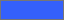
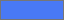
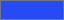
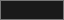
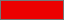
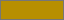

# 基本デザイン

> 各項目の`ローカル参照`は`generate-screen-design-rules` Skillに同梱されたファイルを指し、本プロジェクトには含まれません。詳細は[README.md](./README.md)を参照してください。

色、余白、文字、角丸、影、ブレークポイントなど、画面全体に共通する基本ルールを定義します。

## 1. 余白

<!-- template-only:start -->
- **状態:** 暫定
- **出典:** DADS
- **参照ヒント:** 基本デザイン > 余白
- **ローカル参照:** `references/dads/foundations/spacing/index.md`
<!-- template-only:end -->

### 説明

画面ごとに余白がばらつかないよう、余白の考え方と使用できる値を統一します。

### 規約

余白は **8 CSS pxを基準単位**として設計します。

暫定の余白スケールは以下とします。

| 用途 | 暫定値 |
|---|---:|
| 小さい間隔 | 8px |
| 関連する項目間 | 16px |
| セクション内の大きめの間隔 | 24px |
| セクション間 | 32px |
| 大きな区切り | 64px |

> DADSの考え方をもとにした暫定値です。プロジェクトで変更する場合は、この表を更新してください。

<!-- template-only:start -->
### 確認事項

- [ ] 上記の余白スケールを採用する
- [ ] プロジェクト用に変更する
<!-- template-only:end -->

---

## 2. 文字

<!-- template-only:start -->
- **状態:** 暫定
- **出典:** DADS
- **参照ヒント:** 基本デザイン > タイポグラフィ
- **ローカル参照:** `references/dads/foundations/typography/index.md`
<!-- template-only:end -->

### 説明

見出しや本文、フォームラベルなどの文字表現を統一します。

### 規約

文字サイズ、太さ、行間、見出し階層はDADSのタイポグラフィを基本とします。

対象：

- ページタイトル
- セクションタイトル
- 小見出し
- 本文
- フォームラベル
- 補足
- エラーメッセージ
- テーブル内テキスト

<!-- template-only:start -->
### 確認事項

- [ ] DADSのテキストスタイルを基本として採用する
- [ ] 業務画面向けに情報密度を調整する
- [ ] プロジェクト指定フォントを利用する
<!-- template-only:end -->

### プロジェクト指定フォント

<!-- template-only:start -->
- **状態:** 暫定
- **出典:** DADS
- **参照ヒント:** 基本デザイン > タイポグラフィ > フォントファミリー
- **ローカル参照:** `references/dads/foundations/typography/index.md`
- **確認事項:** プロジェクト固有の指定がない場合の基本書体として採用するか確認する。
<!-- template-only:end -->

- **基本書体:** Noto Sans JP。
- **等幅書体:** Noto Sans Mono。

プロジェクト固有のフォント指定がある場合は、その指定を優先します。

---

## 3. 色

<!-- template-only:start -->
- **状態:** 暫定
- **基本方針:** DADS
- **参照ヒント:** 基本デザイン > カラー（分類・用途）／Design Token（実HEX値）
- **ローカル参照:** `references/dads/foundations/color/index.md`（分類・用途）＋ `references/dads/design-tokens/tokens.json`（実HEX値。`Color.Semantic.*`／`Color.Key.*`からPrimitiveへのエイリアスを解決する）
<!-- template-only:end -->

### 説明

画面ごとに独自の色を増やさず、用途ごとに色の意味を統一します。

### 規約

`tokens.json`の`Key`スケール（DADS参考実装の既定色相＝青）とグレースケールから、コントラスト比（WCAG）を満たす段階を暫定選定した。キーカラーの色相自体（ここでは青）はプロジェクトのブランドカラーにより変更されるプロジェクト固有の判断事項であり、この表は「同じ選定ロジックで色相だけ差し替える」ためのひな形として扱う。

| 用途 | 色見本 | 値 | 白背景に対するコントラスト比 |
|---|---|---|---|
| Primary |  | `#3460fb`（Key.600） | 4.99:1 |
| Secondary |  | `#4979f5`（Key.500） | 3.93:1（非テキスト用途向け。テキストに使う場合はKey.600以上を使う） |
| Tertiary |  | `#264af4`（Key.700） | 6.23:1 |
| Background |  | `#ffffff`（White） | — |
| Text |  | `#1a1a1a`（Gray-900） | 17.4:1 |
| Border |  | `#949494`（Gray-420。DADSが定める非テキスト要素3:1の基準そのもの） | 3.03:1 |
| Error |  | `#ec0000`（Semantic.Error.1 = Primitive.Red.800） | — |
| Warning |   | `#b78f00`（Semantic.Warning.Yellow.1 = Primitive.Yellow.700。オレンジ系`#fb5b01`も選択可） | — |

<!-- template-only:start -->
### 確認事項

- [ ] キーカラーの色相（既定は青）をこのまま採用する
- [ ] プロジェクトのブランドカラーに合わせて色相を変更する（変更する場合も、`tokens.json`の同じ段階（例: プライマリーはKey.600相当）を選び、コントラスト比を確認すること）
- [ ] Warningの色系統（Yellow / Orange）を選択する
<!-- template-only:end -->

### 禁止事項

- 同じ意味の状態に画面ごとで異なる色を使わない
- 色だけで状態や意味を伝えない

> [AI]
> - 規約にない色を画面単位で独自に追加しないこと。

---

## 4. 角の形状

<!-- template-only:start -->
- **状態:** 暫定
- **出典:** DADS
- **参照ヒント:** 基本デザイン > 角の形状
- **ローカル参照:** `references/dads/foundations/corner-shapes/index.md`
<!-- template-only:end -->

### 説明

ボタンや入力欄などの角をどの程度丸くするかを定め、同じ役割の部品の形をそろえます。

### 規約

ボタン、入力欄、カードなど、同じ種類の部品では角の形状を統一します。

<!-- template-only:start -->
### 確認事項

- [ ] DADSの角の形状を採用する
- [ ] プロジェクト独自の値を設定する
<!-- template-only:end -->

---

## 5. 影・エレベーション

<!-- template-only:start -->
- **状態:** 暫定
- **出典:** DADS
- **参照ヒント:** 基本デザイン > エレベーション
- **ローカル参照:** `references/dads/foundations/elevation/index.md`
<!-- template-only:end -->

### 説明

画面の要素に影を付ける場面と影の強さを定め、要素の重なりや前後関係を伝えます。
エレベーションの高さレベルは、要素が手前に浮いて見える段階であり、要素の縦の寸法ではありません。

### 規約

影は装飾目的で多用せず、要素の重なりや前後関係を示す必要がある場合に利用します。

主な対象：

- Dialog / Modal
- Drawer / Side Panel
- 浮遊するメニュー
- 必要に応じたカード

---

## 6. ブレークポイント

<!-- template-only:start -->
- **状態:** 要確認
- **参考:** DADS
- **参照ヒント:** 基本デザイン > レイアウト > ブレークポイント
- **ローカル参照:** `references/dads/foundations/layout/index.md`
<!-- template-only:end -->

### 説明

対応端末に応じて、どの画面幅でレイアウトを切り替えるかを決めます。

<!-- template-only:start -->
### 確認事項

- [ ] PC中心
- [ ] タブレット対応
- [ ] スマートフォン対応
- [ ] その他: `[記載]`
- [ ] 想定する画面の幅（PCの場合）: `[記載]`
<!-- template-only:end -->

> 想定する画面の幅は、横に長い画面（表、ツリーなど）が、横にスクロールせずに収まるかを決める基準になります。
> 社内で使われる画面の大きさと、OSの表示の拡大率（例: 125%）を考慮して決めます。

### 使用するブレークポイント

`[要確認]`

---

## 7. Design Token

<!-- template-only:start -->
- **状態:** 暫定
- **出典:** DADS
- **参照ヒント:** 基本デザイン（カラー／タイポグラフィ等、各ページのトークン記載）、`digital-go-jp/design-tokens` リポジトリ
- **検索キーワード:** デザイントークン, Design Token
- **ローカル参照:** `references/dads/design-tokens/tokens.json`（Color / Typography / Sizeのトークン定義。実HEX値含む）
<!-- template-only:end -->

### 説明

複数の画面で使う色や余白などの値を共通の名前で管理し、画面ごとのばらつきを防ぎます。

### 規約

色、余白、文字、角丸など、複数画面で共通利用する値は可能な限りDesign Tokenとして管理します。

DADSのDesign Tokenを基本とし、プロジェクト固有Tokenを追加する場合は、既存Tokenで表現できない理由を確認してから追加します。

> CSS変数やTailwind CSSへの具体的な落とし込み方は、必要に応じてフロントエンド実装規約で定義します。
